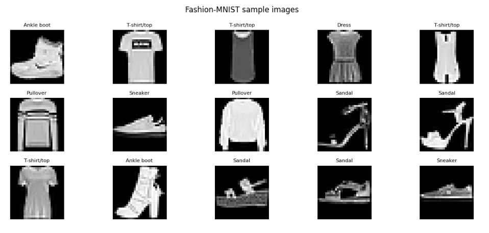
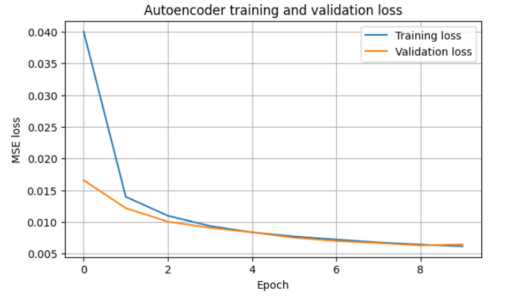
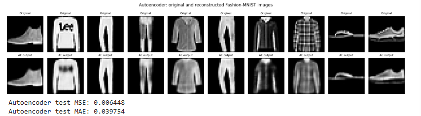
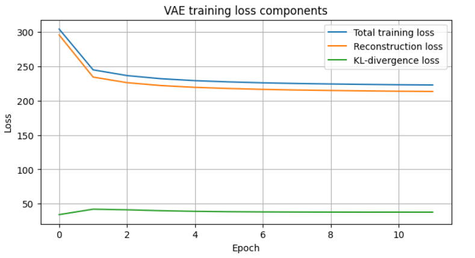
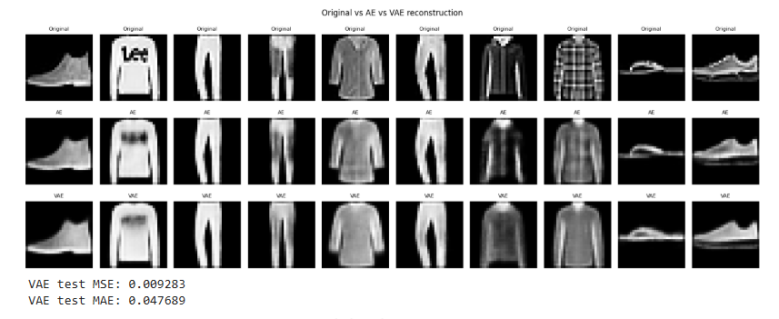
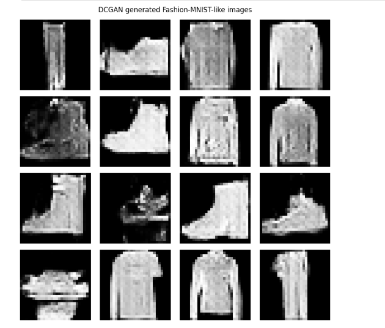
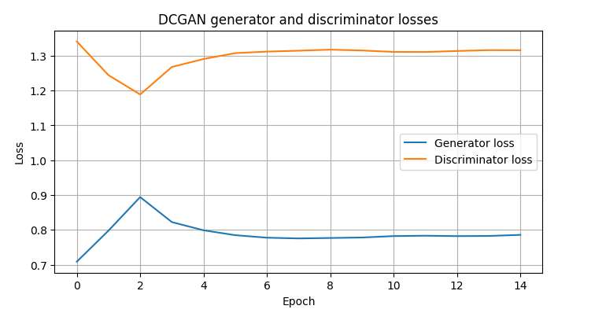
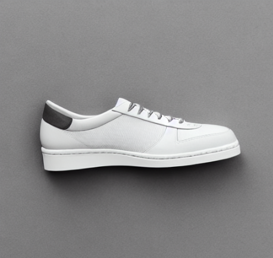

# Generative AI Lab – Assignment 02

## Comparative Study and Practical Analysis of Generative AI Models
### Image Reconstruction and Image Generation Using Autoencoder, VAE, DCGAN and Stable Diffusion

## 1. Student Details

**Name:** Sakshi Uttam Walunj  
**PRN:** 202502110007  
**Class:** T.Y. B.Tech  
**Batch:** A3  
**Department:** Computer Science and Engineering (AI & ML)  
**Course:** Generative AI Lab  
**Institute:** MIT Academy of Engineering, Alandi, Pune  

**Group Members:**
- Shreya Dattaram Bhosale
- Dhanashri Shah

**Submission Date:** 31 October 2026

---

## 2. Introduction

This assignment focuses on understanding and practically implementing different Generative AI models used for image reconstruction and image generation.

Four models are studied: Convolutional Autoencoder, Variational Autoencoder (VAE), Deep Convolutional Generative Adversarial Network (DCGAN), and pretrained Stable Diffusion.

The practical work covers two course outcomes:

- **CO3 – Image Reconstruction:** Implementing Autoencoder and VAE for reconstructing images.
- **CO4 – Image Generation:** Implementing DCGAN and using a pretrained Stable Diffusion model for generating images.

The experiments demonstrate how different model architectures learn image representations and produce reconstructed or newly generated outputs.

## 3. Objectives

- Understand the working principles of different generative models.
- Load and preprocess the Fashion-MNIST dataset.
- Implement image reconstruction using Autoencoder and VAE.
- Understand latent-space representation and the reparameterization trick.
- Generate synthetic images using DCGAN.
- Perform text-to-image generation using Stable Diffusion.
- Evaluate reconstruction performance using MSE and MAE.
- Visualize training losses and generated outputs.
- Compare the architectures, advantages, limitations and applications of all four models.

## 4. Dataset Used

### Fashion-MNIST

Fashion-MNIST is used for the Autoencoder, VAE and DCGAN experiments. It contains grayscale images belonging to ten different clothing categories.

| Dataset Property | Description |
|---|---|
| Training images | 60,000 |
| Testing images | 10,000 |
| Image dimensions | 28 × 28 |
| Channels | 1 (grayscale) |
| Number of classes | 10 |
| Pixel range | 0–1 after normalization |

The dataset categories include T-shirt/top, Trouser, Pullover, Dress, Coat, Sandal, Shirt, Sneaker, Bag and Ankle boot.

### Dataset Samples

The following figure displays sample images from Fashion-MNIST.



## 5. Part A – Image Reconstruction (CO3)

### 5.1 Convolutional Autoencoder

A Convolutional Autoencoder learns a compressed representation of an input image and reconstructs the image using a decoder.

**Architecture:**
- Encoder: extracts image features using convolutional layers.
- Latent representation: stores compressed information.
- Decoder: reconstructs the image from the encoded representation.

**Implementation Configuration**

| Parameter | Value |
|---|---|
| Input shape | 28 × 28 × 1 |
| Latent dimension | 128 |
| Optimizer | Adam |
| Learning rate | 0.001 |
| Loss function | Mean Squared Error |
| Epochs | As configured in the notebook |
| Batch size | As configured in the notebook |

**Training and Validation Loss**



**Reconstruction Results**



### 5.2 Variational Autoencoder (VAE)

A Variational Autoencoder learns a probabilistic latent representation. The encoder estimates the mean and log-variance, and the reparameterization trick is used to sample a latent vector.

The decoder uses the sampled latent representation to reconstruct the input image.

**Implementation Configuration**

| Parameter | Value |
|---|---|
| Input shape | 28 × 28 × 1 |
| Latent dimension | 128 |
| Beta | 0.25 |
| Optimizer | Adam |
| Loss function | Reconstruction loss + weighted KL divergence |
| Epochs | As configured in the notebook |
| Batch size | As configured in the notebook |

**Training and Validation Loss**



**Reconstruction Results**



### 5.3 Reconstruction Evaluation

The Autoencoder and VAE are evaluated using the same test dataset. Mean Squared Error (MSE) and Mean Absolute Error (MAE) are used to measure the difference between original and reconstructed images.

| Model | Test MSE | Test MAE |
|---|---:|---:|
| Autoencoder | 0.004870 | 0.033197 |
| Variational Autoencoder | 0.008218 | 0.043392 |

The Autoencoder achieved lower MSE and MAE in this execution, indicating lower pixel-wise reconstruction error. The VAE, however, provides a probabilistic latent space that supports sampling and image generation.

## 6. Part B – Image Generation (CO4)

### 6.1 Deep Convolutional Generative Adversarial Network (DCGAN)

DCGAN uses two neural networks that compete with each other during training.

- **Generator:** Converts random noise vectors into synthetic images.
- **Discriminator:** Learns to distinguish real images from generated images.

Through adversarial training, the generator gradually learns to produce images resembling the Fashion-MNIST dataset.

**Generated Images**



**Generator and Discriminator Loss**



The generated samples are examined for clothing-like structures, visual quality, diversity and image artifacts.

### 6.2 Pretrained Stable Diffusion

Stable Diffusion is a pretrained latent diffusion model used for generating images from text prompts.

Its major components include:

- **Text Encoder:** Converts the input prompt into encoded representations.
- **U-Net:** Performs iterative denoising in latent space.
- **Scheduler:** Controls the denoising steps.
- **VAE:** Converts the final latent representation into an image.

Unlike the previous experiments, Stable Diffusion is not trained on Fashion-MNIST. A pretrained Stable Diffusion v1.5 pipeline is used for text-to-image generation.

**Prompt Used:**

"A high-quality studio product photograph of a single classic white sneaker, side view, isolated on a clean light grey background, soft studio lighting, sharp details, realistic material texture."

**Negative Prompt:**

"Blurry, distorted, low resolution, multiple shoes, cropped object, watermark, text, logo."

**Generation Configuration**

| Parameter | Value |
|---|---|
| Model | Stable Diffusion v1.5 |
| Inference steps | 20 |
| Guidance scale | 7.0 |
| Resolution | 512 × 512 |
| Attention slicing | Enabled |

**Generated Image**



The output is examined based on prompt adherence, object appearance, visual details and overall image quality.

## 7. Comparative Analysis

| Model | Main Purpose | Input | Output |
|---|---|---|---|
| Autoencoder | Image reconstruction | Input image | Reconstructed image |
| VAE | Reconstruction and latent-space generation | Input image or latent sample | Reconstructed or sampled image |
| DCGAN | Synthetic image generation | Random noise | New generated image |
| Stable Diffusion | Text-to-image generation | Text prompt and random noise | Prompt-conditioned image |

### Results and Discussion

The Autoencoder and VAE demonstrate two different approaches to learning image representations and reconstructing input images. Their performance is evaluated using MSE, MAE and visual comparison.

DCGAN generates new Fashion-MNIST-like images from random noise. Unlike reconstruction models, it does not attempt to reproduce a particular input image.

Stable Diffusion generates a high-resolution sneaker image using a text prompt. It demonstrates how a pretrained diffusion model can interpret textual descriptions and convert them into visual outputs.

The experiments highlight the differences between image reconstruction, unconditional image generation and text-conditioned image generation.

## 8. Technologies Used

| Technology | Purpose |
|---|---|
| Python | Main programming language |
| TensorFlow / Keras | Autoencoder, VAE and DCGAN |
| NumPy | Numerical operations |
| Matplotlib | Image visualization and loss plots |
| PyTorch | Stable Diffusion execution |
| Hugging Face Diffusers | Loading the pretrained diffusion model |
| Transformers | Model dependencies |
| Accelerate | Model execution support |
| Google Colab | Cloud-based execution environment |

## 9. Project Structure

```text
Assignment No. 2: Comparative Study/
│
├── Screenshots/
│   ├── 01_fashion_mnist_samples.png
│   ├── 02_autoencoder_loss.png
│   ├── 03_autoencoder_reconstruction.PNG
│   ├── 04_vae_loss.PNG
│   ├── 05_vae_reconstruction.PNG
│   ├── 06_dcgan_generated_grid.PNG
│   ├── 07_dcgan_losses.PNG
│   └── 08_stable_diffusion_output.PNG
│
├── Assignment-02_Presentation.pptx
├── Assignment-02_Comparative_Study_Report.pdf
├── Sakshi_Walunj_Comparative_Study.ipynb
└── readme.md
```

The `Screenshots` folder contains the visual outputs generated during the practical execution. All images are linked using relative paths so they can be displayed directly on GitHub.

## 10. Execution Procedure

1. Open the Jupyter Notebook in Google Colab.
2. Select a GPU runtime for faster model execution.
3. Import the required libraries.
4. Load and preprocess the Fashion-MNIST dataset.
5. Build, train and evaluate the Autoencoder.
6. Build, train and evaluate the VAE.
7. Train DCGAN and visualize its generated samples.
8. Load the pretrained Stable Diffusion pipeline.
9. Generate an image using the specified text prompt.
10. Compare reconstruction metrics and generated outputs.

Stable Diffusion requires access to the pretrained model and its dependencies. GPU execution is recommended.

## 11. AI Tools and Verification

**AI Tool Used:** ChatGPT.

AI assistance was used for understanding model architectures, debugging implementation issues, improving code structure and interpreting experimental results.

**Prompts Used:**
- Explain the working principle of Autoencoder and VAE.
- Help implement image reconstruction using Fashion-MNIST.
- Explain the generator and discriminator in DCGAN.
- Demonstrate text-to-image generation using pretrained Stable Diffusion.
- Compare the four generative AI models based on their outputs and applications.

**Verification:**
- Checked dataset dimensions and normalization.
- Compared original and reconstructed images.
- Evaluated AE and VAE using test-set MSE and MAE.
- Examined DCGAN generated samples and training losses.
- Checked the Stable Diffusion image against the input prompt.
- Referred to official documentation for model concepts and implementation.

## 12. Group Members

- Sakshi Uttam Walunj
- Shreya Dattaram Bhosale
- Dhanashri Shah

## 13. Key Learning Outcomes

- Understanding convolutional Autoencoder architecture.
- Learning probabilistic latent representations in VAE.
- Understanding the reparameterization trick and KL divergence.
- Studying adversarial training using DCGAN.
- Using pretrained Stable Diffusion for text-to-image generation.
- Interpreting training and validation loss curves.
- Comparing reconstruction models using MSE and MAE.
- Understanding the differences between reconstruction and image generation.

## 14. Limitations and Future Scope

**Limitations**
- Fashion-MNIST contains small grayscale images and is simpler than real-world image datasets.
- Reconstruction quality depends on model architecture and training configuration.
- DCGAN training may be unstable and generated images can contain visual artifacts.
- Stable Diffusion requires significant computational resources.
- Reconstruction metrics cannot be directly used to rank models that generate unrelated images.

**Future Scope**
- Experiment with different latent dimensions and VAE beta values.
- Improve DCGAN training stability and image quality.
- Explore conditional GANs for class-specific image generation.
- Fine-tune diffusion models on domain-specific datasets.
- Evaluate generated images using additional quality and diversity metrics.

## 15. Conclusion

This assignment provided practical experience with four different generative AI approaches: Autoencoder, Variational Autoencoder, DCGAN and Stable Diffusion.

The Autoencoder and VAE were used for reconstructing Fashion-MNIST images, while DCGAN generated new clothing-like samples from random noise. Pretrained Stable Diffusion was used to generate an image from a natural-language prompt.

The experiments helped in understanding latent representations, reconstruction losses, adversarial learning and diffusion-based generation. They also demonstrated how different generative model architectures are suited to different image-related tasks.

## 16. References

1. Fashion-MNIST Dataset – https://github.com/zalandoresearch/fashion-mnist
2. TensorFlow Documentation – https://www.tensorflow.org/
3. Kingma, D. P. and Welling, M., "Auto-Encoding Variational Bayes", 2013.
4. Radford, A., Metz, L. and Chintala, S., "Unsupervised Representation Learning with Deep Convolutional Generative Adversarial Networks", 2015.
5. Hugging Face Diffusers Documentation – https://huggingface.co/docs/diffusers
6. Stable Diffusion v1.5 – https://huggingface.co/stable-diffusion-v1-5/stable-diffusion-v1-5

---

**Prepared by:** Sakshi Uttam Walunj  
**PRN:** 202502110007  
**MIT Academy of Engineering, Alandi, Pune**
